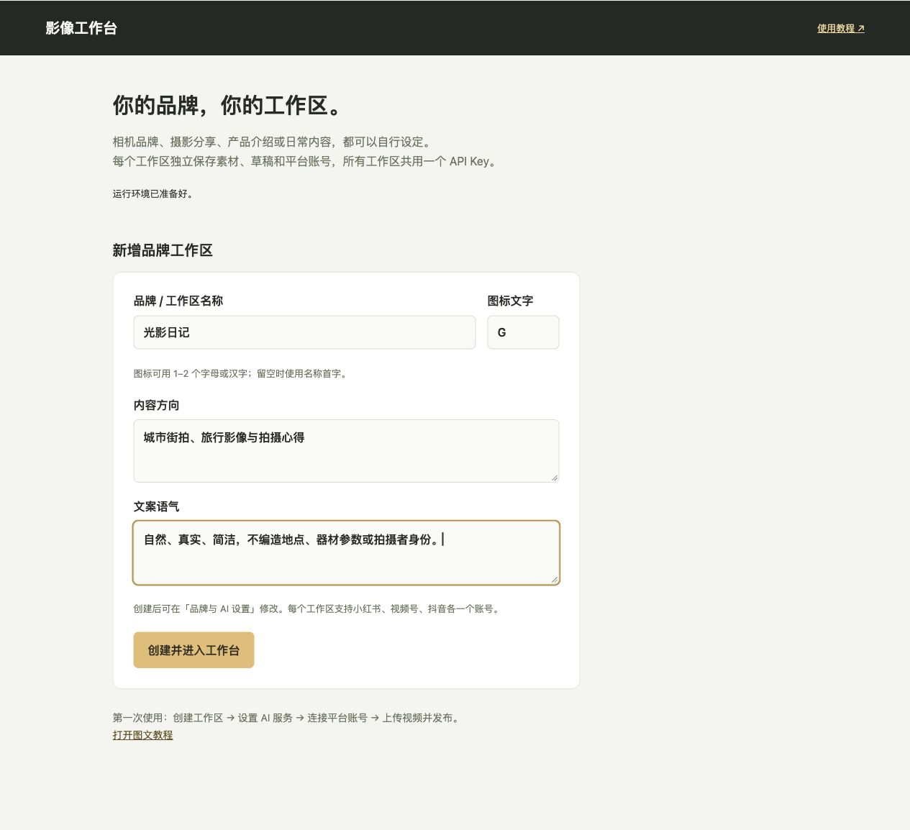
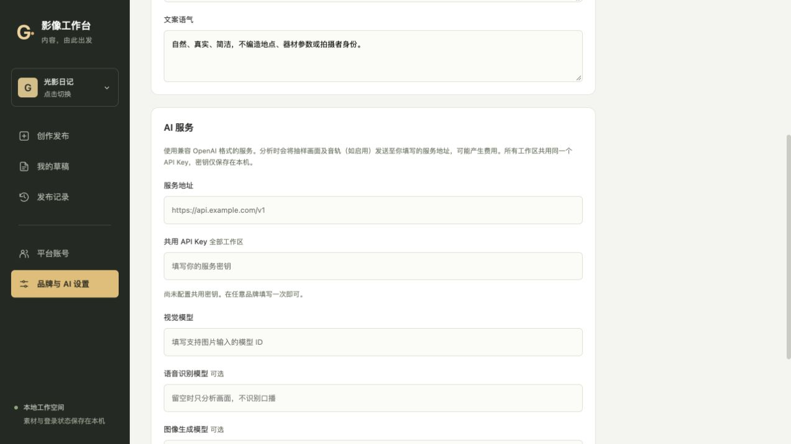
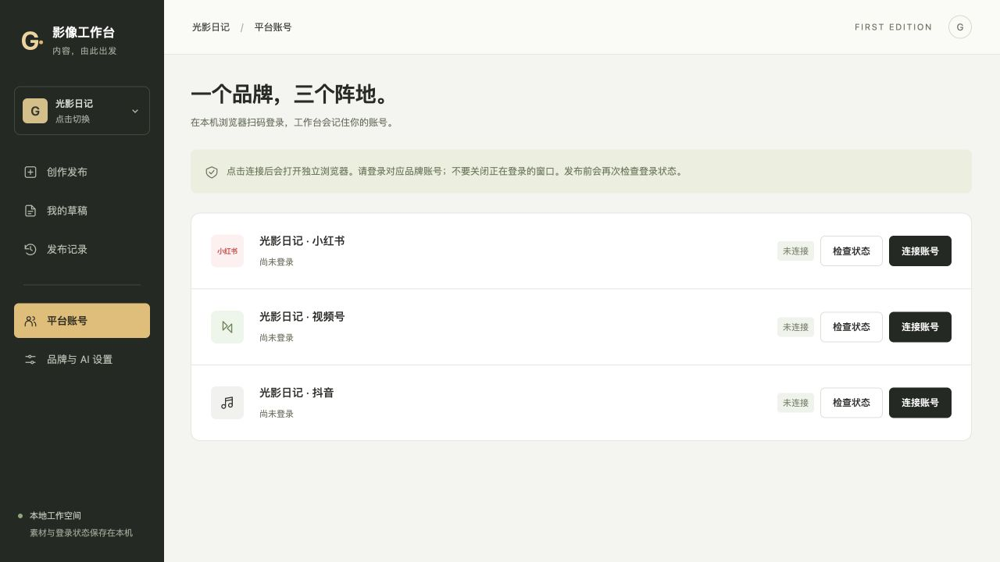
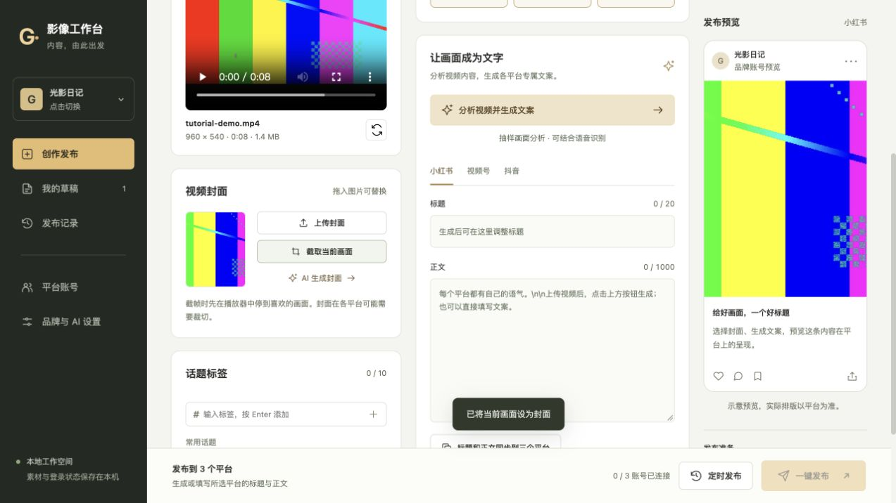
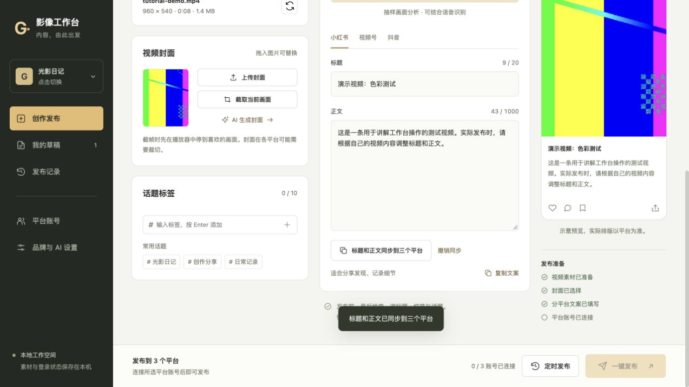
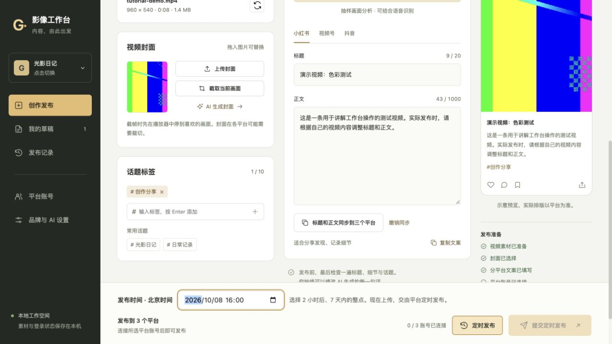
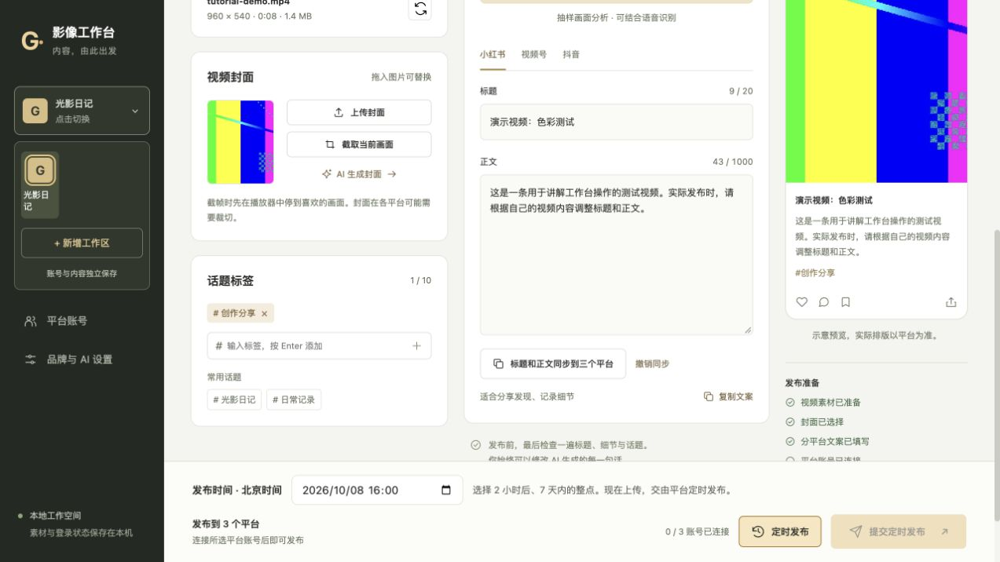
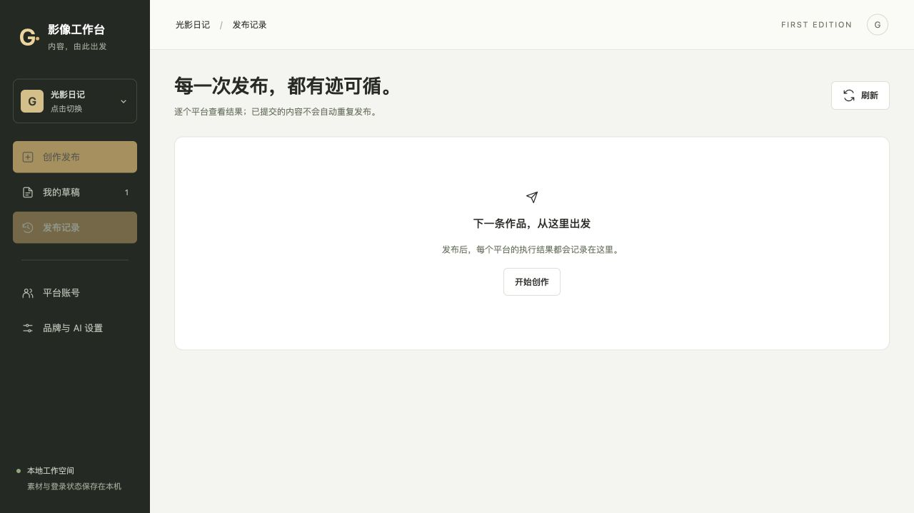

# 图文使用教程

## 1. 创建工作区

第一次启动没有预置品牌、账号或密钥。填写品牌名称、图标文字、内容方向和文案语气，以后从左侧图标切换或新增。

## 2. 配置 AI

填写自己的服务地址、共用 API Key 和视觉模型。语音模型和图像模型为可选项；使用费用由对应模型服务收取。

## 3. 连接平台账号

分别点击连接账号，在 Chrome 中自行扫码和完成平台验证。账号状态按工作区保存；新工作区需要分别登录。

## 4. 上传视频与封面

上传视频后，拖入自己的封面，或从视频截帧。配置兼容图像模型后也可生成封面。

## 5. 核对文案

生成文案后检查标题、正文和标签，可将当前文案一键同步到三个平台。提交前确认文案符合各平台长度限制。

## 6. 立即或定时发布

选择目标平台，核对素材与文案，然后点击发布。定时按中国时间整点设置；账号未连接时发布按钮不可用。

## 7. 切换或新增工作区

点击左侧品牌图标。切换会保存当前草稿，上传或分析进行中先完成操作，设置页未保存的内容会提示。

## 8. 查看结果

逐个平台查看状态。「已提交」只说明观察到提交成功信号，最终审核与展示以平台为准。结果不确定时，先确认平台没有发布，再决定重试。

以上图片使用演示数据，不展示真实密钥或账号。仓库仅提供图文教程。
